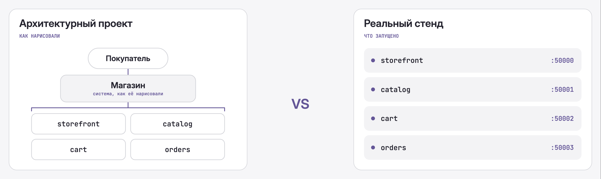
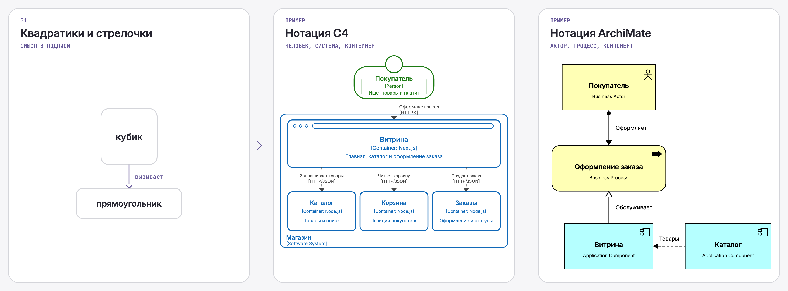
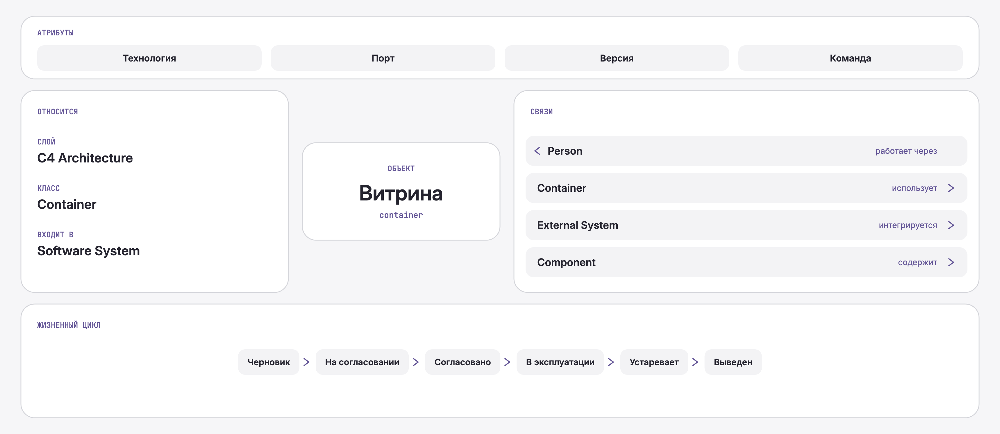

# 1. Минутка теории и инструмент AIVA

## Задача

Архитектурный проект и реализация часто живут отдельно. Вопрос воркшопа: как контролировать, что проект соответствует реализации.

## Основные определения

Кратко здесь; полный словарь платформы — [TERMS.md](../files/TERMS.md).

**Нотация** — соглашение, как рисовать архитектуру: какие фигуры бывают и что они означают. Примеры: C4, ArchiMate, «квадратики и стрелочки». Нотация отвечает на вопрос «как это выглядит на схеме».

**Метамодель** — язык описания в AIVA: какие объекты вообще можно создать, какими свойствами они обладают, какие связи допустимы и какие статусы проходит решение. Сегодня язык — C4.

**Модель** — конкретная архитектура на этом языке: объекты, свойства, связи и статусы. Не картинка, а набор проверяемых утверждений. После сохранения источник правды — **репозиторий** AIVA.

Совпадает ли проект с реализацией, вы проверите сами на шаге 5.

## Приложение на стенде

Магазин уже развёрнут: собирать его из этого репозитория не нужно.

| Что открыть | URL |
| --- | --- |
| Aiva | https://archdays2026.aiva-pro.tech |
| Витрина | https://ecomarch.aiva-pro.tech |
| Статус сервисов | https://ecomarch.aiva-pro.tech/status |
| Письма после заказа | https://ecomarch.aiva-pro.tech/outbox/ |

Найдите в поиске «книга», откройте товар, положите в корзину, оформите заказ. После заказа в outbox есть письмо. На `/status` — сервисы, которые сейчас запущены.

Целевую схему на этом шаге не открываем. Список на `/status` не заменяет проект.

Дальше: [02_project.md](02_project.md).
