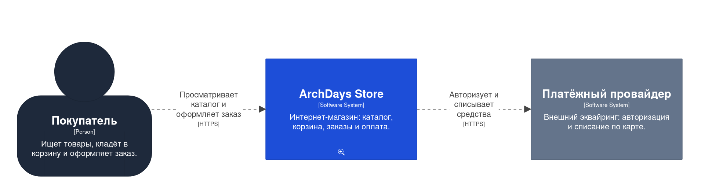
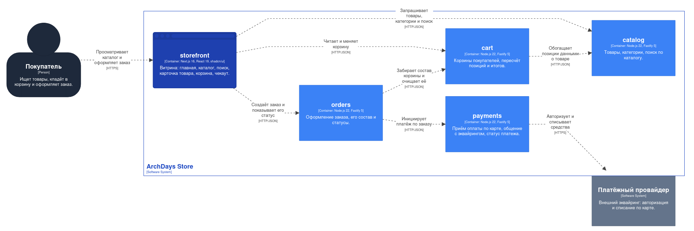

# 2. Обзор архитектурного проекта

Проект магазина описан в нотации C4 и лежит в репозитории как Structurizr DSL: [files/workspace.dsl](../files/workspace.dsl). На шаге 3 загрузим его в AIVA.

## Контекст

Покупатель, система ArchDays Store и внешний платёжный провайдер.

## Контейнеры

Внутри системы: витрина, каталог, корзина, заказы, платежи. Платежи ходят во внешнего провайдера.

Запомните стрелки: кто кого вызывает. Это проект. Он не подменяется списком со страницы `/status`: именно проект мы потом сравним с фактом.

Дальше: [03_model.md](03_model.md).
